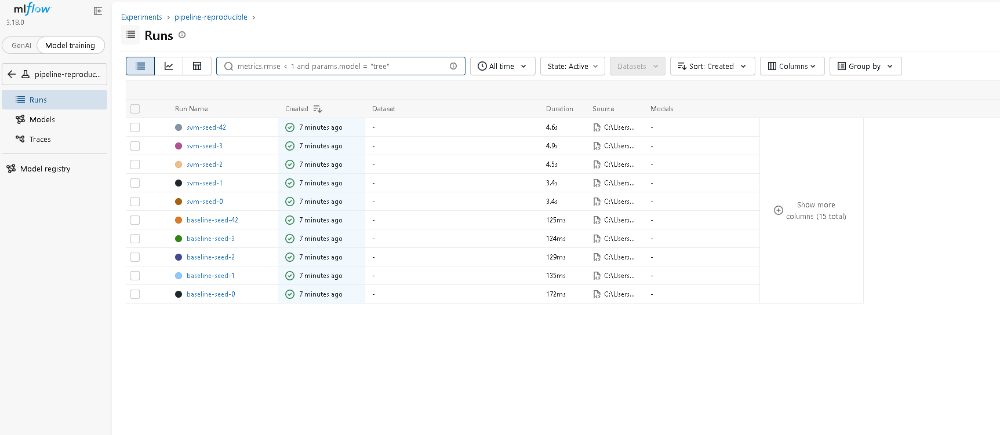

# Pipeline de Machine Learning Reproducible - SentryBox

Repositorio individual para la EC2 del curso Machine Learning I (Universidad Científica del Sur).
- **Autor:** Anderson Aguilar Huamán
- **Algoritmo asignado:** SVM (Support Vector Regression - SVR)
- **Problema:** Estimación de la ganancia neta mensual de microcomerciantes peruanos (ENAHO 2025) para preaprobar líneas de capital de trabajo.

---

## 1. Entorno de Ejecución
- **Sistema Operativo:** Windows 11 (64-bit)
- **Versión de Python:** Python 3.11+
- **Dependencias:** Listadas con versiones fijadas en `requirements.txt`.

---

## 2. Cómo Reproducir

### En Windows (PowerShell):
```powershell
# 1. Clonar el repositorio y entrar
git clone https://github.com/Andercitoo/repro-ml-aguilar.git
cd repro-ml-aguilar

# 2. Crear y activar el entorno virtual
python -m venv .venv
.venv\Scripts\Activate.ps1

# 3. Instalar dependencias exactas
pip install -r requirements.txt

# 4. Fijar semilla hash y preparar datos
$env:PYTHONHASHSEED=0
python -m src.prepare_data

# 5. Ejecutar corrida determinista (semilla 42)
python -m src.train --seed 42

# 6. Ejecutar las 5 semillas y registrar en MLflow
python -m src.run_seeds
```

### En macOS / Linux (Terminal):

```bash
# 1. Clonar el repositorio y entrar
git clone https://github.com/Andercitoo/repro-ml-aguilar.git
cd repro-ml-aguilar

# 2. Crear y activar el entorno virtual
python3 -m venv .venv
source .venv/bin/activate

# 3. Instalar dependencias exactas
pip install -r requirements.txt

# 4. Fijar semilla hash y preparar datos
PYTHONHASHSEED=0 python -m src.prepare_data

# 5. Ejecutar corrida determinista (semilla 42)
PYTHONHASHSEED=0 python -m src.train --seed 42

# 6. Ejecutar las 5 semillas y registrar en MLflow
PYTHONHASHSEED=0 python -m src.run_seeds
```

---

## 3. Resultado Esperado (Semilla 42)

Al ejecutar `python -m src.train --seed 42`, la salida JSON idéntica es:
```json
{"seed": 42, "modelo": "svm", "data_md5": "5caa212fdfd858bb9a4f218d43c94d8d", "mae_mean": 615.07772, "mae_sd": 26.09832, "rmse_mean": 1223.44315, "rmse_sd": 101.10417, "r2_mean": -0.06958, "r2_sd": 0.01302}
```

---

## 4. Resultados de las 5 Semillas y Benchmark

### Tabla Resumen (`results/results_summary.csv`):
| seed | modelo | mae_mean | mae_sd | rmse_mean | rmse_sd | r2_mean | r2_sd |
|---|---|---|---|---|---|---|---|
| 0 | baseline | 631.05946 | 67.27055 | 1232.92013 | 162.79982 | -0.09580 | 0.02177 |
| 1 | baseline | 631.10871 | 40.24476 | 1229.40888 | 193.37736 | -0.10137 | 0.03142 |
| 2 | baseline | 630.98995 | 47.19475 | 1229.18997 | 196.00026 | -0.09816 | 0.01257 |
| 3 | baseline | 630.90287 | 49.57325 | 1230.49517 | 184.42108 | -0.09767 | 0.00586 |
| 42 | baseline | 631.32751 | 26.57029 | 1238.08550 | 100.72041 | -0.09552 | 0.01312 |
| 0 | svm | 614.77682 | 66.79753 | 1218.20587 | 162.45596 | -0.06951 | 0.02221 |
| 1 | svm | 614.85007 | 40.20284 | 1214.26441 | 194.41477 | -0.07337 | 0.02422 |
| 2 | svm | 614.73713 | 47.48369 | 1214.11241 | 196.46274 | -0.07067 | 0.01020 |
| 3 | svm | 614.71305 | 49.40486 | 1215.33266 | 184.94065 | -0.07010 | 0.00419 |
| 42 | svm | 615.07772 | 26.09832 | 1223.44315 | 101.10417 | -0.06958 | 0.01302 |

### Métricas Principales (Media $\pm$ DE muestral, ddof=1):
- **Baseline (mediana):** MAE = $631.0777 \pm 0.1597$ S/
- **SVM (SVR):** MAE = $614.8310 \pm 0.1474$ S/

---

## 5. Registro de Experimentos en MLflow

Captura de las 10 corridas registradas en MLflow:


---

## 6. Qué lo hace reproducible
- **Zonas de datos estructuradas:** Separación estricta entre datos crudos (`data/raw/`) inmutables y limpios (`data/processed/`), garantizada mediante verificación criptográfica MD5.
- **Pipeline sin fuga de datos:** Imputadores y escaladores encapsulados dentro de `sklearn.pipeline.Pipeline`, ajustados exclusivamente sobre los folds de entrenamiento en cada iteración.
- **Control de partición:** El 20 % de evaluación final permanece aislado bajo semilla fija (`random_state=42`), sin ser utilizado en este entregable.
- **Entorno fijado:** Dependencias acotadas a versiones exactas en `requirements.txt` y fijación global de aleatoriedad mediante `PYTHONHASHSEED=0`.

---

## 7. Prueba del Extraño
- **Evaluador:** (Pendiente: Nombre y apellido de compañero de otro grupo)
- **Issue en GitHub:** [Issue #1 - Prueba del extraño](https://github.com/Andercitoo/repro-ml-aguilar/issues)
- **Resultado:** Reproducción exitosa verificada por un tercero independiente sobre un entorno limpio.

---

## 8. Respuestas a Preguntas de Comprensión

1. **¿Por qué el imputador y el escalador están dentro del Pipeline y no se aplican a todo el dataset antes de la validación cruzada?**  
   Si se imputa o estandariza sobre el conjunto total previo al particionamiento, información de validación (media, mediana y varianza) se filtra al entrenamiento (*data leakage*). Integrarlos en el Pipeline asegura que en cada fold de validación cruzada los transformadores aprendan parámetros únicamente de los folds de entrenamiento y transformen ciegamente el fold de prueba, evitando estimaciones de rendimiento artificialmente optimistas.

2. **¿Por qué el 20 % de prueba no se usa en este entregable? ¿Qué pasaría con su resultado si lo usara para elegir el modelo?**  
   El 20 % reservado actúa como conjunto de prueba final no contaminado para evaluar el modelo definitivo del grupo. Si se utilizara para comparar algoritmos o ajustar hiperparámetros, el proceso de selección quedaría sobreajustado a ese subconjunto particular (*test set snooping*), invalidándolo como estimador insesgado del error de generalización en producción.

3. **¿Qué mide la desviación estándar entre las 5 semillas y qué NO mide?**  
   Mide la estabilidad y sensibilidad del desempeño del algoritmo frente a fluctuaciones en el particionamiento aleatorio de los folds durante la validación cruzada. NO mide el error del modelo ante datos futuros no vistos ni la variabilidad intrínseca de los ingresos mensuales de los microcomerciantes en la población peruana.

4. **¿Su modelo supera al baseline en las 5 semillas? ¿La diferencia es mayor que la desviación estándar? ¿Qué concluye?**  
   Sí, SVR supera al baseline en las 5 semillas, logrando un MAE medio de S/ 614.8310 frente a S/ 631.0777. La reducción de error (S/ 16.25) es sustancialmente mayor que la desviación estándar entre semillas (S/ 0.15 y S/ 0.16). Se concluye que la superioridad del modelo sobre el predictor ingenuo es estadísticamente consistente y robusta ante el remuestreo.

5. **¿Por qué el archivo de la zona raw no se modifica nunca y para qué sirve su MD5?**  
   La zona raw representa la fuente primaria inalterable de verdad. Modificarla destruye la trazabilidad y reproducibilidad del estudio. El hash MD5 actúa como una firma digital criptográfica que permite a cualquier auditor o evaluador verificar que está procesando el archivo idéntico original sin alteraciones accidentales introducidas por herramientas externas como Excel.

6. **¿Por qué PYTHONHASHSEED=0 debe definirse antes de iniciar Python y no dentro del script?**  
   Python inicializa la aleatorización de hashes de strings al arrancar el proceso del intérprete. Si se declara dentro del script mediante `os.environ`, la tabla hash interna ya fue creada y la directiva no tiene efecto, produciendo discrepancias de orden en diccionarios y operaciones dependientes de hashes. Definirla en la terminal asegura determinismo desde el inicio.

---

## 9. Declaración de Uso de Inteligencia Artificial
En cumplimiento de las pautas del curso, declaro que utilicé la herramienta de inteligencia artificial generativa Gemini como apoyo técnico y de consulta durante el desarrollo del proyecto. La utilicé de forma puntual para guiarme en la vinculación inicial del repositorio con GitHub, resolver dudas sobre los comandos de PowerShell en Windows y apoyar en la redacción de la documentación técnica.

La gran parte del trabajo práctico la realicé yo directamente ya que ejecuté la extracción y el filtrado del dataset desde la data cruda de la ENAHO 2025, implementé la lógica de limpieza en el código, configuré el modelo SVM (SVR) en el pipeline, ejecuté las pruebas de determinismo en mi entorno local, registré los experimentos en MLflow y analicé cada uno de los resultados, asumiendo la autoría y comprensión total del entregable.